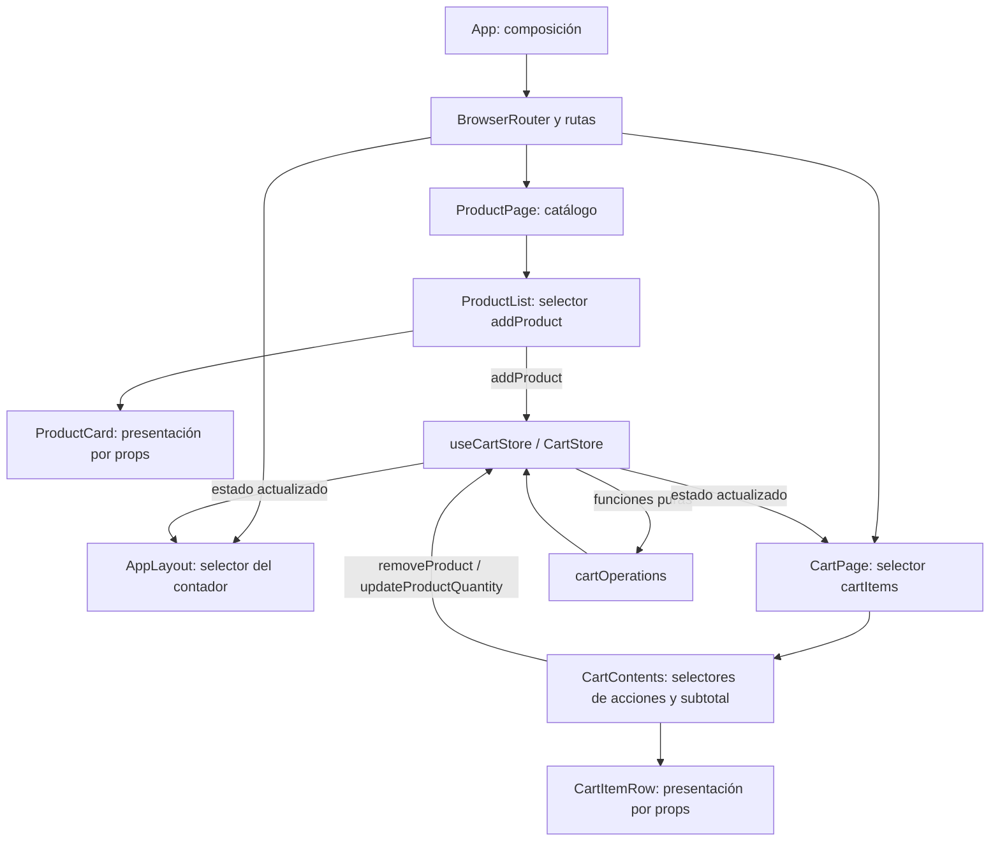

# Arquitectura y evolución del estado

Este documento conserva Stage 0 y Stage 1 como registros históricos y describe la implementación vigente, **Stage 2: Zustand**. Las reglas de negocio siguen en funciones puras; solo cambió el mecanismo que almacena y distribuye el estado. Las comparaciones explican el diseño actual. Se midió un modelo controlado con React Profiler y jsdom; sus resultados orientan sobre renders de los consumidores, pero no sustituyen una prueba en navegador.

## Registro histórico: Stage 0 — LocalReactState

### Comportamiento de Stage 0

En Stage 0, `App.tsx` era el único dueño de `cartItems`, inicializado con `useState<CartItem[]>([])`. `App` definía las funciones para agregar, quitar y cambiar cantidades, calculaba el contador de unidades y declaraba las rutas. El contador del encabezado y la página del carrito compartían estado porque ambos se renderizaban debajo de `App` y del router.

El flujo de productos era `App` → `ProductPage` → `ProductList` → `ProductCard`. El flujo del carrito era `App` → `CartPage` → `CartContents` → `CartItemRow`. El contador pasaba por `AppLayout` → `SiteHeader` → `CartLink`. Los componentes intermedios recibían y reenviaban valores y callbacks aunque no fueran dueños del carrito. Esa propagación explícita era el problema didáctico que Stage 0 pretendía mostrar.

### Ventajas registradas

- El dueño del estado y sus actualizaciones eran visibles en un solo lugar.
- El paso de props hacía evidente el prop drilling.
- Las operaciones puras del dominio se podían probar sin renderizar React.
- Los componentes estaban organizados por funcionalidad y sus props tenían tipos explícitos.
- Los valores derivados no se duplicaban en estado.
- No se añadía una librería de estado ni backend que distrajera de la primera lección.

### Desventajas registradas

1. El prop drilling acoplaba los componentes intermedios a los detalles del carrito. Añadir más niveles requería pasar más props.
2. `App` coordinaba todas las acciones y podía acumular lógica conforme creciera la aplicación.
3. Una actualización del carrito volvía a renderizar `App` y una parte amplia de su árbol, sin suscripciones más específicas.
4. El carrito se perdía al refrescar o remontar la aplicación.
5. Los mensajes del dominio para cantidades máximas o productos inexistentes no se mostraban.
6. Vaciar el campo numérico convertía el valor a cero, lo que eliminaba el producto.
7. No había una ruta de página no encontrada.
8. El catálogo era estático y local.
9. Las pruebas cubrían dominio y componentes, pero no montaban toda la aplicación para verificar el recorrido completo.

Este apartado conserva el enfoque inicial para explicar el problema. Stage 1 y Stage 2 cambian cómo se accede al estado; el catálogo, las reglas del carrito y los límites funcionales se mantienen para poder comparar el mismo caso.

## Registro histórico: Stage 1 — Context API y `useReducer`

En Stage 1, `CartProvider` mantenía `CartState` con `useReducer`. `CartContext` exponía los artículos y las funciones para agregar, quitar y actualizar cantidades. `useCart` encapsulaba el consumo del contexto y avisaba si se usaba fuera del provider. `App` componía el provider, layout y rutas; los consumidores leían el contexto en `AppLayout`, `ProductList`, `CartPage` y `CartContents`.

Las acciones discriminadas (`productAdded`, `productRemoved` y `quantityUpdated`) eran procesadas por `cartReducer`, que delegaba las reglas a las funciones puras de `cartOperations.ts`. `ProductCard` y `CartItemRow` conservaban props de presentación.

### Ventajas de Stage 1

- Reducía el paso de props desde `App` por los componentes intermedios.
- El reducer centralizaba transiciones y hacía explícitas las acciones posibles.
- El hook encapsulaba el acceso y detectaba consumidores fuera del provider.
- Las operaciones puras y las vistas de presentación podían mantenerse independientes de React.
- El contador y el subtotal seguían derivados durante el render, sin efectos ni estado duplicado.

### Desventajas de Stage 1

1. Cada consumidor necesitaba estar bajo `CartProvider`.
2. Un único valor de Context contenía datos y acciones; todos sus consumidores recibían el cambio de ese valor compartido.
3. Había más piezas que en Stage 0: Context, provider, reducer, acciones y hook.
4. Context no persistía el carrito y no resolvía las limitaciones del dominio o de la interfaz.
5. El diseño no tenía selectores nativos para que cada consumidor eligiera una parte del estado.

El reducer, el contexto y el hook de Stage 1 ya no forman parte del código vigente. Se retiraron al migrar a Zustand; quedan descritos aquí para explicar la etapa anterior.

## Implementación vigente: Stage 2 — Zustand

### Qué hace la aplicación

- `/` presenta ocho productos de un catálogo local.
- Agregar un producto repetido incrementa su cantidad.
- `/cart` muestra los artículos, permite cambiar cantidades, quitarlos y ver el subtotal.
- El encabezado suma las unidades de todos los artículos.
- Los precios se muestran en bolivianos con el locale `en-BO`.
- El estado vive en memoria: no hay backend, checkout ni persistencia.

### Responsabilidades actuales

| Ubicación | Responsabilidad |
| --- | --- |
| `src/App.tsx` | Compone router, layout y rutas; no mantiene estado del carrito ni necesita un provider de estado. |
| `src/features/cart/state/cartStore.ts` | Define el contrato `CartStore`, crea el store con `create<CartStore>()` e implementa las acciones usando las funciones puras del dominio. |
| `src/app/layout/AppLayout.tsx` | Selecciona del store el contador total de unidades. |
| `src/features/products/components/ProductList.tsx` | Selecciona la acción `addProduct` y la pasa a `ProductCard`. |
| `src/features/cart/pages/CartPage.tsx` | Selecciona `cartItems` para mostrarlos. |
| `src/features/cart/components/CartContents.tsx` | Selecciona acciones estables de quitar y actualizar; calcula el subtotal y compone filas. |
| `src/features/products/components/ProductCard.tsx` | Vista de presentación con producto y callback de agregar recibidos por props. |
| `src/features/cart/components/CartItemRow.tsx` | Vista de presentación con artículo y callbacks recibidos por props. |
| `src/features/cart/domain/cartTypes.ts` | Tipos de producto y carrito, independientes de React y Zustand. |
| `src/features/cart/domain/cartOperations.ts` | Reglas puras de agregar, quitar, actualizar y calcular subtotal. |
| `src/features/products/repository/productRepository.ts` | Interfaz y catálogo estático local de ocho productos. |
| `src/shared/utils/formatCurrency.ts` | Formato monetario BOB para `en-BO`. |

### Forma del store

`CartStore` reúne `cartItems` y tres acciones tipadas: `addProduct`, `removeProduct` y `updateProductQuantity`. `useCartStore` es el hook creado por Zustand. Cada acción llama a `set` con un nuevo array de artículos producido por `cartOperations.ts`. Zustand mezcla la actualización parcial con el estado anterior; el store no muta la lista ni vuelve a implementar las reglas del carrito.

No hay `CartProvider`: los consumidores importan `useCartStore` directamente. Tampoco se añadió persistencia, middleware, store slices separados ni una abstracción de selector reutilizable; la app tiene un solo estado compartido pequeño.

### Flujo de datos y acciones

`AppLayout` selecciona un número derivado, por lo que solo su selección cambia cuando cambia el total de unidades. `ProductList` selecciona la referencia de la acción `addProduct`, que se conserva en las actualizaciones parciales del store. `CartPage` selecciona el array `cartItems`, que cambia cuando se actualiza el carrito. `CartContents` selecciona dos funciones de acción; además recibe `cartItems` por props desde `CartPage` para renderizar filas y calcular el subtotal.

Los selectores individuales evitan que `ProductList` reaccione a cambios del array del carrito si la función `addProduct` sigue siendo la misma. El contador reacciona cuando cambia su resultado numérico. La lista del carrito sí reacciona cuando cambia el array. Estas conclusiones describen las selecciones configuradas; medir el número y costo de renders requiere perfilar la aplicación.

### Reglas y casos límite conservados

- Un producto nuevo entra con cantidad `1`; las adiciones repetidas se limitan a `99`.
- Quitar filtra por identificador.
- Cantidad menor que `1` o no entera elimina el artículo.
- Cantidad mayor que `99` se limita a `99`.
- Un identificador inexistente conserva el array actual.
- El subtotal se deriva con `calculateSubtotal`; una lista vacía produce cero.
- No se guarda por separado el contador ni el subtotal.

El store guarda el array devuelto en `CartUpdateResult.items`; los mensajes de cantidad máxima o producto inexistente no se muestran. El input convierte una cadena vacía en cero y esa regla elimina el artículo. El refresco de página reinicia el store porque no se configuró persistencia.

### Ventajas y costos actuales de Stage 2

**Ventajas observables en esta implementación:**

- No hay que montar un provider React ni pasar las acciones del carrito desde `App`.
- Cada consumidor selecciona el valor o acción que necesita.
- El comportamiento del store queda aislado en un módulo y conserva los límites del dominio puro.
- Las vistas de producto y fila siguen siendo presentacionales.
- Las pruebas pueden inspeccionar y restablecer el estado del store sin montar toda la app.

**Costos y límites:**

1. Se agrega y se debe aprender una dependencia externa; el estado ya no se entiende solo con las APIs de React.
2. Los componentes importan el store directamente y quedan acoplados a ese módulo de estado.
3. La instancia de store está en el ámbito del módulo y se comparte entre consumidores de esta aplicación; no está diseñada aquí para múltiples tiendas aisladas o renderizado por servidor.
4. Los selectores nuevos deben devolver valores estables. Devolver objetos o arrays nuevos desde un selector sin igualdad apropiada puede causar renders adicionales.
5. La granularidad de suscripción no es persistencia y no garantiza una mejora práctica en todos los escenarios; el microbenchmark incluido confirma que el resultado depende de qué consumidores se actualizan.
6. Los mensajes del dominio se descartan y vaciar el input elimina el artículo, igual que en las etapas previas.

### Comparación desde Stage 0: LocalReactState

| Criterio | Stage 0: enfoque histórico | Stage 1: Context y reducer, histórico | Stage 2: Zustand, actual |
| --- | --- | --- | --- |
| Dueño | `App` con `useState`. | `CartProvider` con `useReducer`. | Store `useCartStore` creado en `cartStore.ts`. |
| Acceso | Props atraviesan páginas y componentes intermedios. | Consumidores llaman `useCart` bajo el provider. | Consumidores seleccionan datos/acciones desde el hook del store. |
| Actualización | Callback vuelve al handler de `App`. | Acción discriminada pasa al reducer. | Acción del store aplica una actualización parcial inmutable. |
| Provider | No requiere provider de estado. | Requiere `CartProvider`. | No requiere provider React. |
| Prop drilling | Explícito y creciente. | Reducido para datos globales, aún quedan props de presentación. | Reducido; quedan props entre componentes de presentación. |
| Suscripción | El dueño de estado actualiza su subárbol. | Un solo Context notifica a todos sus consumidores. | Cada componente usa selector; la granularidad está definida, el costo de render no se ha perfilado. |
| Facilidad para enseñar | Hace visible el problema y el viaje de cada prop. | Muestra el patrón nativo de Context + reducer. | Muestra un store externo y acceso por selectores. |
| Costo principal | Cableado y handlers concentrados en `App`. | Provider obligatorio y valor de Context compartido. | Dependencia externa, import directo del store y cuidado con la estabilidad de selectores. |

**Guion desde Stage 0:** traza `onAddProduct` desde `App` hasta la tarjeta y de vuelta; repite con las acciones de la fila del carrito. Después compara con los consumidores de Context y los selectores Zustand. La pregunta didáctica es qué cableado desaparece y qué abstracción nueva se incorpora en cada paso.

### Comparación desde Stage 1: Context API y `useReducer`

| Criterio | Stage 0: hacia atrás | Stage 1: Context + reducer | Stage 2: Zustand, actual |
| --- | --- | --- | --- |
| Ubicación | `useState` y handlers en `App`. | Estado en `CartProvider`; transiciones en reducer. | Estado y acciones en store externo. |
| Forma de consumir | Props desde ancestros. | `useCart()` devuelve todo el valor de Context. | Cada componente pasa un selector a `useCartStore`. |
| Forma de expresar acciones | Callbacks con actualización desde `App`. | Union discriminada de acciones y reducer exhaustivo. | Métodos nombrados dentro del store; no hay union de acciones ni switch. |
| Árbol React | No se instala una frontera de estado aparte. | Consumidores dependen de estar bajo provider. | No existe provider de Zustand en el árbol. |
| Renderizado esperado | La actualización del dueño puede renderizar su subárbol. | El objeto de contexto cambia y notifica a todos sus consumidores. | Las selecciones atómicas limitan qué cambios observa cada consumidor; falta medir su costo real. |
| Organización | Menos módulos, lógica de conexión en el componente alto. | Más módulos de infraestructura y transiciones explícitas. | Un módulo de store, acciones locales a este y selectores en consumidores. |
| Ventaja de Stage 1 frente a 0 | — | Quita el paso manual de props y mantiene transición explícita con APIs de React. | — |
| Diferencia de Stage 2 frente a 1 | — | Context comparte el valor completo con todos los consumidores. | Los consumidores seleccionan una parte; no necesitan provider, pero dependen directamente de Zustand. |
| Elección para esta demo | Bueno para enseñar el problema inicial. | Bueno para explicar Context y reducer sin dependencia externa. | Bueno para contrastar un store externo y selectores; la elección final requiere valorar el costo conceptual y perfilar renders. |

**Guion desde Stage 1:** sigue una actualización desde un método de Context al `dispatch`, del reducer a `cartOperations`, y observa qué consumidores del contexto se notifican. Luego recorre el mismo evento desde el selector/action del store. Compara explícitamente la union de acciones del reducer con los métodos del store y el requisito de provider con la importación directa del hook.

## Archivos clave e interesantes por enfoque

Los archivos de Stage 0 y Stage 1 que se listan abajo son referencias históricas: sus implementaciones fueron reemplazadas y ya no están todas en el checkout actual. La lista ayuda a explicar qué mirar en cada etapa, pero el código vigente corresponde a Stage 2.

### Stage 0: LocalReactState

| Archivo representativo | Qué permite explicar |
| --- | --- |
| `src/App.tsx` — versión de Stage 0 | El `useState` dueño del carrito, los handlers y la elevación del estado al ancestro común. En el checkout actual `App.tsx` solo compone router y layout. |
| `src/features/products/pages/ProductPage.tsx` y `components/ProductList.tsx` — versión de Stage 0 | El paso explícito de productos y `onAddProduct` a través de niveles intermedios. Las props cambiaron al migrar a Context/Zustand. |
| `src/features/cart/pages/CartPage.tsx` y `components/CartContents.tsx` — versión de Stage 0 | Cómo cartItems y callbacks atravesaban la página y su composición hasta la fila. |
| `src/features/cart/components/CartItemRow.tsx` y `src/features/products/components/ProductCard.tsx` | Los puntos de UI donde se origina una acción. Hoy son componentes de presentación; las implementaciones de Stage 0 recibían los handlers pasados desde `App`. |
| `src/features/cart/domain/cartOperations.ts` | Las funciones puras reutilizables; esta capa se mantuvo a lo largo de las etapas. |

**Para explicar:** comienza en `App.tsx`, sigue un callback hasta el botón y enumera qué componentes solo lo reenvían. Luego muestra que las funciones de dominio no necesitan saber de React.

### Stage 1: Context API y `useReducer`

| Archivo representativo | Qué permitía explicar |
| --- | --- |
| `src/features/cart/state/CartContext.tsx` — histórico, retirado | El límite del provider, el `useReducer` y las funciones que despachaban acciones. |
| `src/features/cart/state/cartReducer.ts` — histórico, retirado | La unión discriminada de acciones y cómo cada transición delegaba a `cartOperations.ts`. |
| `src/features/cart/state/useCart.ts` — histórico, retirado | El hook de acceso y el error explícito fuera de `CartProvider`. |
| `src/App.tsx` — versión de Stage 1 | La composición del provider sobre layout y rutas; `App` dejó de poseer el estado. |
| `src/features/cart/state/cartReducer.test.ts` y `useCart.test.tsx` — históricos, retirados | Pruebas del estado inicial, las acciones y el uso del hook bajo/sin provider. |
| `src/features/cart/domain/cartOperations.ts` | El dominio puro conservado, separado del reducer y del contexto. |

**Para explicar:** despacha una acción, sigue el `switch` del reducer y llega a la función pura. Después compara el acceso a `useCart` con el recorrido largo de props de Stage 0. Estos archivos ya no están en el árbol vigente; la historia está registrada aquí y puede revisarse en Git solo si se crearon commits para esa etapa.

### Stage 2: Zustand — código vigente

| Archivo vigente | Qué conviene observar |
| --- | --- |
| `src/features/cart/state/cartStore.ts` | El tipo `CartStore`, el store creado con Zustand, las tres acciones y su delegación al dominio. Es el punto central de la implementación actual. |
| `src/app/layout/AppLayout.tsx` | El selector que deriva el contador total de unidades; compara el resultado seleccionado, no recibe todo el store. |
| `src/features/products/components/ProductList.tsx` | El selector de la referencia estable `addProduct` y el paso de esa acción a la tarjeta visual. |
| `src/features/cart/pages/CartPage.tsx` | La selección de `cartItems` desde el store para la ruta del carrito. |
| `src/features/cart/components/CartContents.tsx` | Selectores de acciones, estado vacío, subtotal derivado y composición de filas. |
| `src/features/cart/domain/cartOperations.ts` | La misma fuente de reglas puras usada por las etapas anteriores. |
| `src/features/cart/state/cartStore.test.ts` | Estado inicial, acciones, inmutabilidad, cantidades límite e ID inexistente. |
| `src/features/cart/pages/CartPage.test.tsx` | Recorrido de UI conectado al store: agregar, cambiar cantidad, validar subtotal y quitar. |
| `package.json` | La dependencia Zustand necesaria para construir el store. |

**Para explicar:** selecciona `addProduct` en `ProductList`, actualiza el store y observa los selectores de contador y carrito. Señala también qué selecciones permanecen iguales y por qué eso puede evitar renders de ese consumidor; usa React Profiler antes de convertir esa observación en una afirmación de rendimiento.

## Recomendación final: Stage 2 gana para esta aplicación

Para la tienda demo actual, recomiendo **Stage 2: Zustand** como implementación final. El carrito se comparte entre rutas y varios componentes distantes lo necesitan; el store evita un provider React, permite que cada consumidor seleccione un valor concreto y mantiene las reglas del negocio en las mismas funciones puras. El código vigente expresa esta separación en un módulo pequeño y no extiende el prop drilling desde `App`.

La recomendación es específica a esta aplicación y a sus objetivos actuales, no una regla universal:

- **Stage 0** gana si el objetivo principal de una clase es hacer visible el problema del prop drilling; no es la opción recomendada para mantener esta UI cuando crecen los consumidores.
- **Stage 1** es una buena elección si se quiere limitar dependencias y enseñar APIs nativas de React con acciones de reducer explícitas. Para este carrito, su provider y el Context compartido agregan cableado que Zustand evita.
- **Stage 2** es la recomendación práctica aquí por acceso directo y selectores. A cambio, agrega dependencia externa, acopla consumidores al store y requiere cuidado con la estabilidad de las selecciones.

La recomendación sí considera el microbenchmark controlado, pero no trata sus tiempos como una prueba universal: Stage 2 evita renders del listado en la ruta de productos y no gana en el escenario de estrés del carrito. El argumento ganador sigue siendo el ajuste de la arquitectura al flujo actual y el costo de integración. Si el requisito de no añadir dependencias cambia, Stage 1 puede ser la mejor decisión. En la demo, conviene presentar los tres enfoques: Stage 0 como problema, Stage 1 como solución nativa y Stage 2 como opción recomendada para esta app.

### Tamaño de la implementación, rendimiento y criterios de decisión

Para estimar el tamaño, conté las líneas físicas y las no vacías de los archivos de TypeScript/TSX que poseen, transportan o consumen el estado del carrito. Se incluyen `App.tsx`, `AppLayout.tsx`, `ProductPage.tsx`, `ProductList.tsx`, `CartPage.tsx`, `CartContents.tsx`, `CartLink.tsx` y `SiteHeader.tsx`; en Stage 1 se agregan los tres módulos de Context/reducer/hook, y en Stage 2 se agrega `cartStore.ts`. Se excluyen pruebas, reglas puras del dominio, repositorio de productos, hojas de estilo y documentación, que no son el mecanismo de estado comparado.

| Etapa | Archivos contados | Líneas físicas | Líneas no vacías | Diferencia frente a Stage 0 |
| --- | ---: | ---: | ---: | ---: |
| Stage 0: LocalReactState | 8 | 238 | 217 | — |
| Stage 1: Context API y `useReducer` | 11 | 298 | 262 | +60 físicas (+45 no vacías) |
| Stage 2: Zustand | 9 | 223 | 201 | -15 físicas (-16 no vacías) |

Los conteos de Stage 0 y Stage 1 se tomaron de los commits `22a1f22` y `9d31e6c`; Stage 2 se contó en el árbol actual. Con este alcance, Stage 2 tiene 75 líneas físicas menos que Stage 1. El resultado puede variar si se incluyen pruebas, comentarios, UI compartida o archivos auxiliares; por eso se registra el alcance junto con la cifra. La menor cantidad de líneas no prueba que una opción sea más rápida ni universalmente más simple.

Se ejecutó un microbenchmark controlado con React Profiler en Node.js y jsdom, usando componentes que representan el árbol de consumidores y el patrón de acceso al estado de cada etapa. No es un benchmark de la app completa en un navegador: jsdom no mide layout, pintura ni latencia real de interacción, y las versiones históricas no se montaron desde sus commits. El script reproducible está en `scripts/benchmark-state-management.mjs` y se ejecuta con `npm run benchmark:state`.

El microbenchmark usó Node `v24.15.0`, React/React DOM `19.3.1`, Zustand `5.0.16` y jsdom `27.4.0`; hizo 25 repeticiones medidas, 3 de calentamiento y 80 acciones por repetición. En el escenario de productos se usó un catálogo de ocho tarjetas y se repitió agregar el mismo producto. En el escenario de carrito se usaron 100 filas y se actualizó repetidamente la cantidad de una fila. Las reglas de actualización fueron equivalentes y cada etapa se ejecutó en el mismo proceso y entorno.

| Escenario | Etapa | Mediana `actualDuration` por acción | P95 `actualDuration` por acción | Mediana de tiempo de actualización | Renders relevantes por acción |
| --- | --- | ---: | ---: | ---: | --- |
| Productos, 8 tarjetas | Stage 0 | 0,0396 ms | 0,3082 ms | 0,1081 ms | `ProductList`: 1; tarjetas: 8 |
| Productos, 8 tarjetas | Stage 1 | 0,0429 ms | 0,3462 ms | 0,1087 ms | `ProductList`: 1; tarjetas: 8 |
| Productos, 8 tarjetas | Stage 2 | 0,0037 ms | 0,0067 ms | 0,0220 ms | `ProductList`: 0; tarjetas: 0 |
| Carrito, 100 filas | Stage 0 | 0,4513 ms | 2,8832 ms | 0,7350 ms | página: 1; contenido: 1; filas: 100 |
| Carrito, 100 filas | Stage 1 | 0,7618 ms | 4,7312 ms | 1,1995 ms | página: 1; contenido: 1; filas: 100 |
| Carrito, 100 filas | Stage 2 | 0,9431 ms | 3,8539 ms | 1,4668 ms | página: 1; contenido: 1; filas: 100 |

En la ruta de productos, los selectores de Zustand evitaron el render de `ProductList` y sus ocho tarjetas en este modelo; el contador del encabezado sí se actualizó. En el estrés de carrito, las tres etapas volvieron a renderizar las cien filas y Stage 2 tuvo mayor mediana de duración que las otras dos en esta corrida. Una repetición del script puede cambiar los valores absolutos por la variabilidad de una microprueba; el resultado más estable es el conteo de renders por consumidor. Estos milisegundos no predicen por sí solos la experiencia real.

Para validar rendimiento en navegador, montar cada commit en un entorno aislado y usar la misma versión de Node, dependencias, navegador, dispositivo y build de producción. Repetir la misma secuencia de interacciones y catálogo; medir renders, commits, `actualDuration` y tiempo desde la interacción al commit visible. No inferir rapidez por el número de renders solamente: comparar también duración y variabilidad.

### Tamaño del bundle y dependencias

También medí el build de producción con Vite `8.3.5` y Node `v24.15.0`. Stage 0 y Stage 1 se construyeron desde sus commits históricos (`22a1f22`, `9d31e6c`) y Stage 2 desde el árbol actual, en directorios temporales aislados y con las mismas versiones instaladas de React, Vite y el resto de dependencias. Se usó `vite build` para medir el bundle; el conteo no incluye el chequeo de tipos de TypeScript.

| Etapa | Módulos transformados | JavaScript minificado | JavaScript gzip según Vite | Dependencias runtime directas |
| --- | ---: | ---: | ---: | ---: |
| Stage 0 | 38 | 267,29 kB | 85,21 kB | 3 |
| Stage 1 | 41 | 267,77 kB | 85,40 kB | 3 |
| Stage 2 | 42 | 267,49 kB | 85,39 kB | 4 |

El CSS resultó igual en las tres etapas: 5,68 kB minificado y 1,84 kB gzip. Stage 2 añade una dependencia runtime directa (Zustand) frente a Stage 0; el JS gzip aumentó 0,18 kB frente a Stage 0 y fue 0,01 kB menor que Stage 1 en esta salida. La diferencia comprimida es pequeña para esta app. El número de módulos transformados es una referencia del build, no una medida de calidad ni de rendimiento.

| Criterio | Qué comparar | Lectura para esta demo |
| --- | --- | --- |
| Líneas y módulos | Huella de implementación con un alcance publicado. | Ya medida arriba; orienta sobre tamaño, no sobre calidad aislada. |
| Renders y duración | Renders por consumidor, commits y tiempo del profiler en escenarios idénticos. | Hay un microbenchmark controlado; falta perfilar el navegador y la app completa. |
| Latencia percibida | Tiempo entre una acción de usuario y la actualización visible. | Relevante al cambiar cantidades o agregar productos. |
| Complejidad de mantenimiento | Cableado, dependencias y conceptos que debe entender el equipo. | Stage 0 es directo al inicio; Stage 1 tiene más piezas; Stage 2 añade Zustand y selectores. |
| Acoplamiento y extensibilidad | Cuántos componentes conocen el mecanismo y cuánto cambia al sumar consumidores/acciones. | Contrasta props, provider/contexto y acceso directo al store. |
| Pruebas | Facilidad de probar dominio, transiciones y recorridos UI; casos límite cubiertos. | Las reglas puras se comparten; cada mecanismo tiene pruebas específicas. |
| Tamaño del bundle | Bytes comprimidos en builds comparables. | Mide el costo real de Zustand en esta aplicación. |
| Adecuación a requisitos | Persistencia, SSR, aislamiento, dependencias permitidas y experiencia del equipo. | Puede cambiar qué etapa conviene elegir. |

Para declarar un ganador global, asignar pesos a estos criterios según los objetivos de la demo y evaluar cada etapa con la misma escala. En esta app pequeña, adecuación funcional, costo de integración y mantenibilidad deberían pesar más que diferencias de milisegundos en una microprueba. Si el objetivo principal cambia a enseñar APIs nativas o evitar dependencias, el ganador puede cambiar. La conclusión actual recomienda Stage 2 por encaje arquitectónico; sus cifras de rendimiento son indicativas y deben confirmarse en navegador.

## Pruebas vigentes

- `cartOperations.test.ts` prueba las reglas puras.
- `cartStore.test.ts` prueba estado inicial, acciones, actualizaciones inmutables, límites y producto inexistente.
- `CartPage.test.tsx` prueba el flujo UI conectado al store: agregar, cambiar cantidad, calcular subtotal y quitar.
- `ProductCard.test.tsx` prueba el callback accesible del componente de presentación.

`cartReducer.test.ts` y `useCart.test.tsx` pertenecían a Stage 1 y se retiraron junto con el reducer y Context. Ejecutar lint, typecheck, pruebas y build después de sincronizar la dependencia Zustand con `npm install`.
