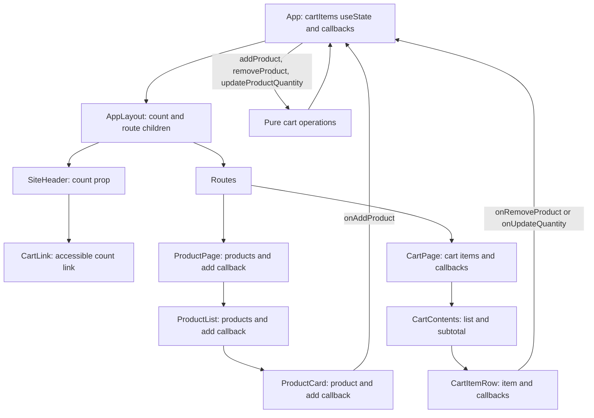

# Current Application Architecture

This guide documents Stage 0, `LocalReactState`, as it exists now. The cart uses local React state in `App`; Context, `useReducer`, Zustand, persistence, and performance optimizations are future work and are not present in the code.

## What the app does

- `/` displays eight sample products from a local in-memory catalog.
- A product can be added repeatedly. Repeated additions increase its quantity.
- `/cart` displays each cart item, accepts quantity changes, removes items, and calculates the subtotal.
- The header displays the total number of units in the cart, not the number of distinct products.
- Prices are formatted as Bolivian bolivianos using the `en-BO` locale.
- No server, checkout, search, account, or browser storage is connected.

## Source boundaries

| Location | Responsibility |
| --- | --- |
| `src/App.tsx` | Owns `cartItems`, defines cart callbacks, derives the unit count, and declares the routes. |
| `src/app/layout/AppLayout.tsx` | Places the shared header above the active route content. |
| `src/shared/components/SiteHeader.tsx` | Displays the brand and navigation, forwarding the count to `CartLink`. |
| `src/features/products/repository/productRepository.ts` | Defines `ProductRepository` and a static catalog of eight products. |
| `src/features/products/pages/ProductPage.tsx` | Receives the catalog and add callback, then renders `ProductList`. |
| `src/features/products/components/ProductList.tsx` | Renders cards with stable product IDs as keys. |
| `src/features/products/components/ProductCard.tsx` | Displays product details and invokes the supplied add callback. |
| `src/features/cart/domain/cartTypes.ts` | Defines `Product`, `CartItem`, and `CartUpdateResult`. |
| `src/features/cart/domain/cartOperations.ts` | Contains framework-independent add, remove, quantity, and subtotal functions. |
| `src/features/cart/pages/CartPage.tsx` | Receives cart values and callbacks, then composes `CartContents`. |
| `src/features/cart/components/CartContents.tsx` | Displays the empty state or item list and derives the subtotal. |
| `src/features/cart/components/CartItemRow.tsx` | Displays a line item and reports quantity/removal actions through props. |
| `src/features/cart/components/CartLink.tsx` | Displays the unit count and a pluralized accessible cart label. |
| `src/shared/utils/formatCurrency.ts` | Formats numeric prices as BOB for English in Bolivia. |

## State ownership and data flow

`App` is the single owner of `cartItems`, initialized to an empty array with `useState<CartItem[]>([])`. The value is not duplicated in the header or cart page. `App` defines three callbacks:

- `handleAddProduct` calls `addProduct` inside the functional state setter.
- `handleRemoveProduct` calls `removeProduct` inside the functional state setter.
- `handleUpdateQuantity` calls `updateProductQuantity` and stores the returned `items` array.

The count is derived on each render by summing every item's quantity. The subtotal is derived by `calculateSubtotal` in `CartContents`; neither derived value is stored as separate state.

The props cross three component boundaries after the route element on the product path (`ProductPage` → `ProductList` → `ProductCard`) and the cart path (`CartPage` → `CartContents` → `CartItemRow`). The header count also passes through `AppLayout` and `SiteHeader` before reaching `CartLink`. These intermediate components do not own the cart; they forward values and callbacks so the nested consumer can use them.

## Cart rules currently implemented

- Adding a new product creates an item with quantity `1`.
- Adding an existing product increments its quantity, capped at `99` by the quantity operation.
- Removing filters out the selected ID.
- A quantity below `1` or a non-integer quantity removes the item.
- A quantity above `99` is capped at `99`.
- Updating a missing product returns the original items and a message.
- The subtotal is the sum of `price × quantity`; an empty cart has a subtotal of zero, though the UI displays the empty state instead of the summary.

The `message` in `CartUpdateResult` is currently not surfaced. `App` stores only `.items`, so users do not see a notice when a quantity is capped or an unknown product is updated. The numeric input also converts an empty string to `0`; because values below one remove the item, clearing the field can remove that item immediately.

## State lifetime

The cart stays available while navigating between `/` and `/cart` because the router and both route elements are descendants of the same mounted `App`. The cart resets on a full page refresh or when the app remounts because it is only in memory. There is no local storage, session storage, or backend persistence.

## Advantages of this baseline

- State ownership and updates are visible in one place.
- The data path makes prop drilling easy to demonstrate and inspect.
- Pure domain operations can be tested without rendering React.
- The UI is split into feature components, and its props are explicitly typed.
- Derived values stay out of state, avoiding synchronization code.
- The app has no state library or backend setup to obscure the first lesson.

## Disadvantages and current limits

1. **Prop drilling couples intermediate components to cart details.** `ProductPage`, `ProductList`, `CartPage`, and `CartContents` forward values or callbacks even when their main role is composition. Adding another nested level means threading the props through it too.
2. **The state owner coordinates all cart actions.** As features grow, `App` can accumulate more handlers and knowledge of cart behavior.
3. **Updates can rerender a broad part of the tree.** A cart change updates `App`, which recreates the layout and route elements. The app has no memoization or finer-grained subscriptions; this is acceptable for the current small catalog but may cause extra rendering in a larger interface.
4. **Cart state is not persistent.** Refreshing or closing the page loses the selection.
5. **Domain messages are discarded.** Quantity-cap and missing-product messages are returned by the pure function but `App` keeps only the item array.
6. **Clearing the quantity input removes the item.** An empty input becomes numeric zero, and zero is treated as below the allowed minimum.
7. **There is no not-found route.** A URL other than `/` or `/cart` renders the shared layout with empty route content.
8. **The catalog is static.** The repository is an interface over a local array, not an asynchronous API or persistence layer.
9. **Tests focus on pure operations and individual components.** They do not currently mount the full `App` to verify routing and the complete user journey together.

## Tests and tools

Vitest runs pure-operation tests and Testing Library component tests. UI tests query controls by accessible role and name. Vite provides development and production builds; TypeScript has strict checking and the `@/` alias. ESLint includes TypeScript, React Hooks, and React Refresh rules. `index.html` declares English as the document language, and the visible UI and accessible labels are written in English.

## Suggested walkthrough

1. Start at `App.tsx` and identify `useState`, the three callbacks, and the derived unit count.
2. Follow `onAddProduct` from `App` through `ProductPage` and `ProductList` to `ProductCard`.
3. Follow `cartItems` and both cart callbacks through `CartPage` and `CartContents` to `CartItemRow`.
4. Trace each callback back to the pure functions in `cartOperations.ts`.
5. Compare the current limitations with Stage 1 (Context API and `useReducer`) and Stage 2 (Zustand). Keep those migrations in separate future commits.
