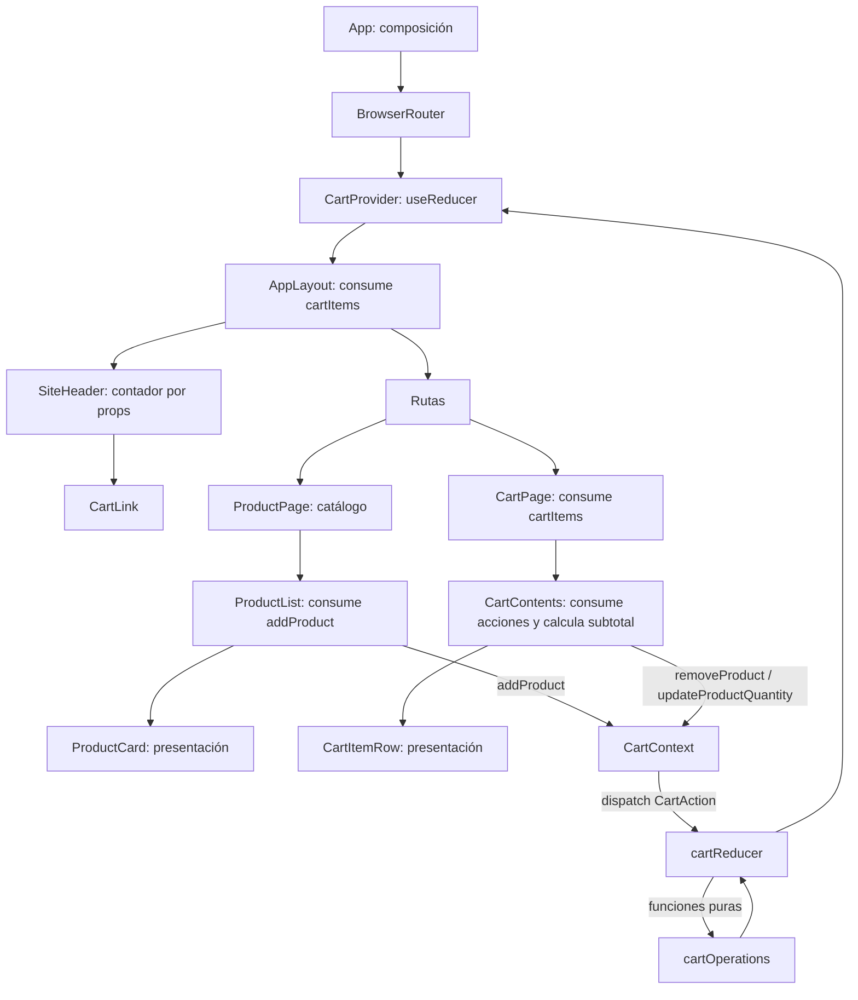

# Arquitectura y evolución del estado

Este documento conserva el registro histórico de **Stage 0: LocalReactState** y describe la implementación vigente, **Stage 1: Context API y `useReducer`**. El futuro **Stage 2: Zustand** aparece como alternativa pendiente, no como código existente. La comparación sirve para preparar una demo; la decisión sobre qué enfoque conviene debe tomarse después de implementar Stage 2 y contrastar los mismos recorridos y pruebas.

## Registro histórico: Stage 0 — LocalReactState

### Comportamiento de Stage 0

En Stage 0, `App.tsx` era el único dueño de `cartItems`, inicializado con `useState<CartItem[]>([])`. `App` definía las funciones para agregar, quitar y cambiar cantidades, calculaba el contador de unidades y declaraba las rutas. El contador del encabezado y la página del carrito compartían estado porque ambos se renderizaban debajo de `App` y del router.

El flujo de productos era `App` → `ProductPage` → `ProductList` → `ProductCard`. El flujo del carrito era `App` → `CartPage` → `CartContents` → `CartItemRow`. El contador pasaba por `AppLayout` → `SiteHeader` → `CartLink`. Los componentes intermedios recibían y reenviaban valores y callbacks aunque no fueran dueños del carrito. Esa propagación explícita era el problema didáctico que Stage 0 pretendía mostrar.

### Ventajas registradas

- El dueño del estado y sus actualizaciones eran visibles en un solo lugar.
- El paso de props hacía evidente el prop drilling.
- Las operaciones puras del dominio se podían probar sin renderizar React.
- Los componentes estaban organizados por funcionalidad y sus props tenían tipos explícitos.
- Los valores derivados no se duplicaban en estado.
- No se añadía una librería de estado ni backend que distrajera de la primera lección.

### Desventajas registradas

1. El prop drilling acoplaba los componentes intermedios a los detalles del carrito. Añadir más niveles requería pasar más props.
2. `App` coordinaba todas las acciones y podía acumular lógica conforme creciera la aplicación.
3. Una actualización del carrito volvía a renderizar `App` y una parte amplia de su árbol, sin suscripciones más específicas.
4. El carrito se perdía al refrescar o remontar la aplicación.
5. Los mensajes del dominio para cantidades máximas o productos inexistentes no se mostraban.
6. Vaciar el campo numérico convertía el valor a cero, lo que eliminaba el producto.
7. No había una ruta de página no encontrada.
8. El catálogo era estático y local.
9. Las pruebas cubrían dominio y componentes, pero no montaban toda la aplicación para verificar el recorrido completo.

Este registro describe el enfoque original y sus límites. Stage 1 cambia el mecanismo de acceso al estado, pero conserva las reglas de negocio y varias limitaciones funcionales para que la comparación sea justa.

## Implementación vigente: Stage 1 — Context API y `useReducer`

### Qué hace la aplicación

- `/` muestra ocho productos de un catálogo en memoria.
- Agregar otra vez un producto incrementa su cantidad.
- `/cart` muestra productos, permite editar cantidades y quitar artículos, y calcula el subtotal.
- El encabezado muestra la suma de unidades, no el número de productos distintos.
- Los precios usan BOB y el locale `en-BO`.
- No hay backend, checkout ni persistencia en el navegador.

### Responsabilidades por módulo

| Ubicación | Responsabilidad actual |
| --- | --- |
| `src/App.tsx` | Compone `BrowserRouter`, `CartProvider`, layout y rutas; ya no posee el estado ni define acciones. |
| `src/features/cart/state/cartReducer.ts` | Define `CartState`, las acciones discriminadas, el estado inicial y las transiciones del carrito. |
| `src/features/cart/state/CartContext.tsx` | Ejecuta `cartReducer` con `useReducer`, crea las funciones de despacho y expone el valor del Context. |
| `src/features/cart/state/useCart.ts` | Expone el Context mediante un hook tipado y da un error claro si falta el provider. |
| `src/app/layout/AppLayout.tsx` | Consume el carrito y deriva el contador del encabezado durante el render. |
| `src/shared/components/SiteHeader.tsx` | Compone la navegación y pasa el contador a `CartLink`. |
| `src/features/products/repository/productRepository.ts` | Define el contrato `ProductRepository` y los ocho productos locales. |
| `src/features/products/pages/ProductPage.tsx` | Recibe el catálogo y compone `ProductList`. |
| `src/features/products/components/ProductList.tsx` | Consume la acción `addProduct` del Context y la pasa a la tarjeta visual. |
| `src/features/products/components/ProductCard.tsx` | Componente de presentación: recibe un producto y una acción por props. |
| `src/features/cart/pages/CartPage.tsx` | Consume los artículos del carrito y compone `CartContents`. |
| `src/features/cart/components/CartContents.tsx` | Consume las acciones, presenta el estado vacío o la lista y calcula el subtotal. |
| `src/features/cart/components/CartItemRow.tsx` | Componente de presentación que recibe artículo y acciones por props. |
| `src/features/cart/domain/cartTypes.ts` | Define `Product`, `CartItem` y `CartUpdateResult`, independientes de React. |
| `src/features/cart/domain/cartOperations.ts` | Implementa las operaciones puras para agregar, quitar, cambiar cantidades y sumar el subtotal. |

### Propiedad del estado y actualización

`CartProvider` se monta dentro de `BrowserRouter` y rodea el layout y ambas rutas. El provider ejecuta `useReducer(cartReducer, initialCartState)`. Su valor del Context expone la lista `cartItems` y tres funciones: `addProduct`, `removeProduct` y `updateProductQuantity`. Cada función despacha una acción discriminada (`productAdded`, `productRemoved` o `quantityUpdated`). El reducer delega las reglas a las funciones puras de `cartOperations.ts` y guarda el nuevo array en `CartState.items`.

Los componentes consumen el hook donde necesitan datos o acciones. `AppLayout` lee artículos para derivar el contador; `ProductList` obtiene la acción para agregar; `CartPage` obtiene los artículos; `CartContents` obtiene las acciones para pasar a las filas. `ProductCard` y `CartItemRow` siguen siendo componentes de presentación con props explícitas.

El contador y el subtotal se derivan durante el render. No se guardan como estado separado ni se sincronizan con efectos.

### Reglas de dominio que se mantienen

- Un producto nuevo comienza con cantidad `1`; una adición repetida incrementa la cantidad hasta `99`.
- Quitar filtra el identificador indicado.
- Una cantidad menor que `1` o no entera elimina el artículo.
- Una cantidad sobre `99` se limita a `99`.
- Actualizar un identificador inexistente conserva los artículos actuales.
- El subtotal es la suma de `precio × cantidad`; para una lista vacía el cálculo devuelve cero.

El reducer solo almacena `CartUpdateResult.items`. Los mensajes devueltos para cantidades limitadas o identificadores inexistentes no llegan a la interfaz. El input numérico convierte una cadena vacía en cero; por la regla anterior, borrar el campo elimina el artículo.

### Ciclo de vida y límites

La navegación entre `/` y `/cart` conserva el carrito mientras siga montado `CartProvider`. Un refresco de página o remontaje reinicia el estado porque sigue siendo solo memoria local.

El Context tiene un único valor que contiene tanto los artículos como las acciones. Ese objeto se crea de nuevo en cada render del provider. Cada componente que llama `useCart` queda suscrito a ese valor compartido y puede volver a renderizar ante una actualización, incluso si solo utiliza una parte. No se añadieron `useMemo`, `useCallback` ni Context separados: la optimización de renders queda fuera de esta etapa y se debe medir antes de introducirla.

### Ventajas de Stage 1

- Los componentes consumidores ya no reciben el carrito y sus acciones a través de todos los niveles desde `App`.
- El reducer centraliza y hace explícitas las transiciones con un conjunto finito de acciones tipadas.
- El hook encapsula el acceso al Context y detecta su uso fuera del provider.
- Los componentes visuales `ProductCard` y `CartItemRow` conservan props simples y se pueden probar aisladamente.
- Las operaciones de dominio siguen siendo puras, reutilizables y probables sin React.
- El estado derivado continúa calculándose durante el render, sin efectos ni copias redundantes.

### Desventajas y costos de Stage 1

1. Los consumidores dependen del Context y deben estar bajo `CartProvider`; esto agrega un límite de composición obligatorio.
2. Un solo Context provoca notificaciones a todos sus consumidores cuando cambia su valor. En esta aplicación, layout, listado y componentes del carrito leen el mismo contexto.
3. La superficie de Context, provider, reducer, acciones y hook requiere más conceptos y archivos que Stage 0.
4. El estado sigue siendo efímero; Context no añade persistencia por sí mismo.
5. Las notificaciones del dominio siguen sin mostrarse y el campo vacío sigue eliminando artículos.
6. La arquitectura no ofrece selectores nativos de estado por componente; separar estado y acciones o crear contextos más específicos sería otra decisión, no parte de esta etapa.

### Pruebas vigentes

`cartOperations.test.ts` mantiene cobertura del dominio puro. `cartReducer.test.ts` verifica estado inicial, acciones, inmutabilidad, cantidades límite y producto inexistente. `useCart.test.tsx` comprueba el error fuera del provider. `CartPage.test.tsx` recorre un caso integrado con `CartProvider`: agrega un artículo, cambia cantidad, comprueba subtotal y lo quita. `ProductCard.test.tsx` verifica la acción de la tarjeta de presentación.

## Comparación para la demo

Stage 2 todavía no está implementado. La columna de Zustand anticipa las propiedades esperadas del diseño propuesto; no debe presentarse como resultado medido hasta crear el store y repetir las pruebas y el recorrido.

| Criterio | Stage 0: LocalReactState | Stage 1: Context API y `useReducer` | Stage 2: Zustand, pendiente |
| --- | --- | --- | --- |
| Dueño del estado | `useState` en `App`. | `useReducer` dentro de `CartProvider`. | Store externo creado con Zustand. |
| Cómo accede un consumidor | Recibe props desde ancestros. | Llama `useCart` dentro del provider. | Lee un selector del hook del store. |
| Cómo se expresa una transición | Callback de `App` llama una función del dominio. | Despacha una acción tipada; el reducer llama al dominio. | Acción del store llama al dominio y actualiza el store. |
| Provider de estado | No requiere uno. | Requiere `CartProvider`. | El store hook de Zustand no requiere un provider React. |
| Prop drilling | Alto y visible; útil para enseñar el problema. | Bajo para el estado global; todavía se pasan props de presentación. | Bajo para el estado global; props de presentación siguen aplicando. |
| Suscripción/renderizado | El dueño actualiza y vuelve a renderizar su subárbol. | Los consumidores del valor compartido se actualizan juntos. | Los selectores pueden limitar qué valor observa cada consumidor; el efecto real debe medirse. |
| Complejidad inicial | La menor; solo React local. | Intermedia; Context, provider, reducer y hook. | Requiere dependencia externa y aprender su store/hook. |
| Punto fuerte para enseñar | Prop drilling y elevación del estado. | Acciones explícitas y Context nativo de React. | Store externo, selectores y actualización desde consumidores sin provider. |
| Trade-off principal | Mucho cableado de props. | Re-render compartido y dependencia del provider. | API/dependencia adicional y decisiones sobre límites/selectores. |

## Comparaciones detalladas para la demo

### Comparación desde Stage 0: LocalReactState

Esta vista toma Stage 0 como punto de partida. Sirve para explicar qué problema está mostrando la primera versión y qué cambia al introducir Context o Zustand. En la columna Stage 2 se describe una expectativa que deberá comprobarse cuando Zustand exista en el proyecto.

| Aspecto | Stage 0: LocalReactState | Cambio en Stage 1: Context y `useReducer` | Cambio esperado en Stage 2: Zustand |
| --- | --- | --- | --- |
| Dueño del carrito | `App` mantiene `cartItems` con `useState`. | `CartProvider` mantiene `CartState` con `useReducer`; `App` solo compone la aplicación. | Un store Zustand fuera del árbol React mantendría el estado y las acciones. |
| Cómo llega el estado al consumidor | Props viajan desde `App` por páginas y componentes intermedios. | Los consumidores llaman `useCart`; ya no es necesario llevar estado desde `App` por toda la cadena. | Los consumidores leerían el store con el hook de Zustand y selectores. |
| Cómo vuelve una acción | El callback sube desde el componente hasta el handler de `App`. | La función del Context despacha una acción; el reducer llama la operación pura. | Una acción del store actualiza su estado, delegando las reglas al mismo dominio puro. |
| Papel de los componentes intermedios | Deben reenviar props aunque solo compongan partes visuales. | Componentes que necesitan estado consumen el hook; otros conservan props de presentación. | Componentes consumidores pueden leer directamente el selector y mantener props para presentación. |
| Acoplamiento y lectura del flujo | El camino de props es explícito, pero crece con cada nivel. | El árbol queda menos acoplado a las props del carrito; hay que entender provider, hook y reducer. | El árbol no necesita un provider React para el store; hay que entender store y selectores. |
| Renderizado | La actualización nace en `App` y vuelve a renderizar su subárbol. | El valor de Context es compartido; los consumidores de este único contexto reciben las actualizaciones. | Un selector puede suscribirse a una parte del estado; el alcance real de los renders debe medirse. |
| Pruebas | Dominio y componentes se pueden probar por separado; conectar el flujo requiere montar ancestros o simular props. | Se pueden probar reducer, hook protegido por provider y componentes dentro de `CartProvider`. | Se podrían probar store y selectores sin montar un provider; la integración UI debe seguir verificándose. |
| Ventaja didáctica | Permite seguir cada prop y observar el costo del prop drilling. | Muestra una solución nativa de React con acciones explícitas. | Permitiría contrastar un store externo con suscripciones por selector. |
| Costo que permanece | Se repiten props y `App` coordina las actualizaciones. | Hay más conceptos/archivos y todos los consumidores comparten una suscripción al valor de Context. | Se agrega una dependencia externa y una API propia de Zustand; el resultado de render no se presume. |

**Guion para explicar Stage 0:** comienza en `App`, sigue el callback `onAddProduct` hasta `ProductCard` y luego vuelve al handler. Repite el ejercicio para `onUpdateQuantity` desde `CartItemRow`. Señala cuántos componentes participan y qué componentes solo reenvían valores. Después usa las columnas de Stage 1 y Stage 2 para preguntar qué parte del recorrido desaparece y qué nuevo concepto aparece en su lugar.

### Comparación desde Stage 1: Context API y `useReducer`

Esta vista toma la implementación actual como punto de partida. Ayuda a explicar qué resuelve Stage 1 frente a Stage 0 y qué queda por evaluar al implementar Stage 2. Zustand sigue siendo una propuesta: sus ventajas de selectores deben confirmarse con código y mediciones, no asumirse.

| Aspecto | Stage 0: comparación hacia atrás | Stage 1: implementación actual | Stage 2: comparación hacia adelante, pendiente |
| --- | --- | --- | --- |
| Ubicación del estado | El `useState` de `App` concentra estado y actualizaciones en la composición de rutas. | `CartProvider` encierra estado y reducer; `App` queda libre de reglas del carrito. | El estado viviría en un store Zustand definido en el módulo de la funcionalidad. |
| Acceso de páginas/componentes | Reciben datos y callbacks por props desde sus ancestros. | `AppLayout`, `ProductList`, `CartPage` y `CartContents` acceden con `useCart` donde lo necesitan. | Los consumidores elegirían sus valores del store con selectores. |
| Contrato de transición | Los nombres de callbacks muestran operaciones, pero el punto de actualización es el handler de `App`. | `CartAction` define un conjunto discriminado de transiciones; `cartReducer` las aplica. | Las acciones podrían exponerse desde el store; habría que valorar qué tan fácil es rastrearlas frente al reducer explícito. |
| Límites de composición | No hay provider de estado. | Todo consumidor del hook debe estar debajo de `CartProvider`; fuera de él, `useCart` lanza un error intencional. | El hook de Zustand no requiere provider React, aunque el store y sus imports siguen siendo una dependencia de la aplicación. |
| Alcance de suscripción | `App` actualiza su subárbol cuando cambia el carrito. | Un Context contiene datos y acciones; sus consumidores se actualizan cuando cambia el valor compartido. | Los selectores pueden limitar cada suscripción; comprobar si se reduce trabajo requiere medir el mismo escenario. |
| Separación de responsabilidades | Las funciones puras contienen las reglas; `App` las invoca. | Las reglas siguen en `cartOperations`; Context conecta dispatch y UI, reducer coordina acciones. | Se deberían conservar las mismas funciones puras; el store conectaría acciones y estado sin trasladar las reglas de negocio. |
| Ventaja frente a Stage 0 | — | Reduce el cableado de props y formaliza acciones sin agregar una librería externa. | — |
| Costo frente a Stage 0 | — | Introduce provider, Context, reducer, tipo de acción y hook; el objeto de contexto se recrea en cada render. | — |
| Diferencia que Stage 2 permitirá observar | — | El consumidor se suscribe al valor completo del Context compartido. | El consumidor podría seleccionar un fragmento del store; comparar ergonomía, complejidad y renders medidos con el mismo flujo. |
| Estado de la evidencia | Historial documentado; no es el código vigente. | Implementado y con pruebas de dominio, reducer, hook y recorrido de carrito. | Aún no implementado ni medido; no declarar ganador antes de completar la etapa. |

**Guion para explicar Stage 1:** comienza con `CartProvider`, muestra `useReducer` y el tipo `CartAction`, y sigue una acción hasta `cartReducer` y `cartOperations`. Luego enseña los consumidores del hook y compara qué props dejaron de atravesar el árbol. Cierra con la limitación principal: el Context comparte una sola suscripción; Stage 2 permitirá investigar si el modelo de selectores de Zustand mejora la granularidad lo suficiente para justificar otra dependencia.

### Criterios para decidir después de Stage 2

Usar el mismo flujo, los mismos casos límite y pruebas equivalentes en las tres etapas. Comparar claridad del flujo de datos, cantidad de código de conexión, facilidad de pruebas, ergonomía para el equipo y comportamiento de renderizado medido. Elegir el enfoque que resuelva las necesidades reales con menor costo conceptual. Para una clase, también valorar que cada transición se pueda explicar y observar; no declarar un ganador antes de completar la comparación con Zustand.
